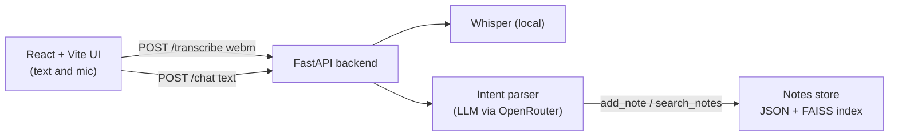

# AI Assistant ("Jarvis")

A voice- and text-driven personal assistant. You talk or type to it in a web chat; an LLM works out
what you want, and when you ask it to remember something it saves a categorized note that it can
later search by meaning.

- **Chat** with a witty, formal "Jarvis" persona.
- **Voice input:** record in the browser, transcribed locally with OpenAI Whisper.
- **Notes memory:** say "add a note to my trips: book the hotel in Porto" and retrieve it later.
  Notes are stored as JSON and indexed with sentence embeddings (FAISS) for semantic search.
- **Intent routing:** every message is classified into an action (`add_note`, `search_notes`,
  or plain chat) and a category, returned by the LLM as structured JSON.

## Architecture



| Part | Tech |
|---|---|
| Backend | Python, FastAPI, Uvicorn |
| LLM | OpenRouter API (OpenAI-compatible client), Mistral 7B Instruct (free tier) |
| Speech-to-text | OpenAI Whisper (`base` model, runs locally, needs `ffmpeg`) |
| Notes memory | LangChain, sentence-transformers (`all-MiniLM-L6-v2`), FAISS |
| Frontend | React, Vite |

## Quick start

**Prerequisites:** Python 3.10+, Node 18+, [`ffmpeg`](https://ffmpeg.org/) on your PATH, and a free
[OpenRouter](https://openrouter.ai) API key.

```bash
# 1. Backend
python -m venv .venv
source .venv/bin/activate        # Windows: .venv\Scripts\activate
pip install -r requirements.txt

cp .env.example .env             # then put your OPENROUTER_API_KEY in .env
uvicorn app.api.main:app --reload --port 8000

# 2. Frontend (in a second terminal)
cd app/ui
npm install
npm run dev                      # opens on http://localhost:5173
```

A terminal-only mode is also available: `python -m app.core.llm_inference`.

## API

| Method | Path | Body | Returns |
|---|---|---|---|
| `POST` | `/chat` | `{"text": "..."}` | `{"response": "...", "result": ...}`: the assistant's reply, plus the found note when a search was requested |
| `POST` | `/transcribe` | multipart `file` (webm audio) | `{"text": "..."}` |

## Project structure

```
app/
├── api/
│   └── main.py            # FastAPI app: /chat, /transcribe, request logging, CORS
├── core/
│   ├── llm_inference.py   # LLM client, intent parser, notes store and semantic search
│   ├── json_utils.py      # Tolerant JSON extraction from LLM output
│   └── speech_text.py     # Optional push-to-talk CLI using local Whisper
└── ui/                    # React + Vite chat interface
tests/                     # pytest unit tests
```

## Configuration

| Variable | Required | Purpose |
|---|---|---|
| `OPENROUTER_API_KEY` | yes | LLM access |
| `CORS_ORIGINS` | no | Comma-separated origins allowed to call the API (defaults to the Vite dev server) |

Secrets live in `.env`, which is git-ignored. See `.env.example`.

## Development

```bash
pip install pytest
pytest
```

CI runs a compile check and the unit tests on every push and pull request.

## Known limitations and roadmap

- The notes search sends a category query through a retrieval chain, so results depend on the
  LLM following the requested JSON format. Malformed output is now handled gracefully, but a
  structured-output or tool-calling approach would be more reliable.
- Only notes are implemented. Reminders / calendar integration is planned, not built.
- Requests are logged with their bodies to `app/api/logs/` (git-ignored). Disable or redact this
  before any shared deployment.
- Dependencies are not yet version-pinned.
- Test coverage is limited to the JSON parsing helper so far.
